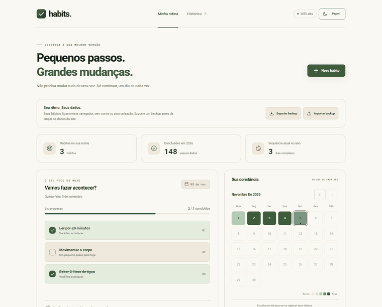

<p align="center">
  <a href="https://will-ifes.github.io/habits/">
    
  </a>
</p>

# Habits · um dia de cada vez

Um espaço pessoal para cultivar hábitos, registrar pequenas conquistas e acompanhar a constância ao longo do ano. Começou no NLW da Rocketseat; a revisão completa a integração com a API e acrescenta uma versão independente para o navegador, com a linguagem visual do [Will Labs](https://github.com/Will-Ifes/will-labs).

**React · TypeScript · Vite 8 · Fastify 5 · Prisma 7 · SQLite** · [Ver online](https://will-ifes.github.io/habits/)

[](https://github.com/Will-Ifes/habits/actions/workflows/ci.yml)

<p align="center">
  <a href="https://will-ifes.github.io/habits/">
    
  </a>
  <br />
  <sub>Clique na demonstração para abrir a aplicação publicada.</sub>
</p>

## O que dá para fazer

- Criar hábitos com recorrência semanal, todos os dias ou dias úteis.
- Marcar e desmarcar conclusões de hoje e de dias anteriores à data atual.
- Navegar pelo calendário mensal e pelo histórico anual, incluindo anos bissextos.
- Acompanhar conclusões e sequência de dias completos no ano atual.
- Renomear hábitos preservando o histórico ou excluí-los com confirmação.
- Alternar entre os temas **Papel** e **Floresta**, seguindo o sistema na primeira visita.
- **Exportar backup** e **Importar backup** em JSON na versão online.

No GitHub Pages, os hábitos ficam **somente neste navegador**, sem conta ou sincronização entre dispositivos. Recarregar a página mantém os registros; limpar os dados do site os remove. A importação valida o arquivo e pede confirmação antes de substituir os dados atuais. Nenhum hábito é enviado a uma API.

## Design

| Fundamento do Will Labs            | Como aparece aqui                                                                                    |
| ---------------------------------- | ---------------------------------------------------------------------------------------------------- |
| Temas `paper` e `forest`           | Cores de `packages/tokens/themes.json`, aplicadas por `data-tema`                                    |
| Roboto + Roboto Mono               | Mono nos números, datas e rótulos curtos                                                             |
| Escala de 4 px e raios 8/16        | Tokens compartilhados e controles/superfícies com raios consistentes                                 |
| Divisão diagonal                   | Marca e favicon                                                                                      |
| Controles de 40 px, 44 px no toque | Navegação, tema e ações dos hábitos                                                                  |
| Acessibilidade                     | Link para pular ao conteúdo, foco visível, modais com Escape e retorno de foco, movimentos reduzidos |

[Captura em Papel](.github/screenshots/desktop.png) · [Captura em Floresta](.github/screenshots/forest.png) · [Captura no celular](.github/screenshots/mobile.png)

## O que mudou na revisão

| Antes                                                     | Depois                                                                   |
| --------------------------------------------------------- | ------------------------------------------------------------------------ |
| Checklist com três exemplos fixos                         | Hábitos reais, recorrência e conclusão persistida                        |
| Cadastro sem atualização do calendário                    | Checklist, totais e histórico atualizados após cada operação             |
| Marcação limitada ao dia atual, sem validar a recorrência | Data explícita, validação de agenda e operação idempotente               |
| Resumo dependia da existência de uma marcação             | Dias previstos aparecem mesmo sem nenhuma conclusão                      |
| Interface centralizada com calendário sem ajuste semanal  | Painéis responsivos, calendário alinhado e histórico anual navegável     |
| Vite 4, Fastify 4 e Prisma 4                              | Dependências atualizadas e instalação única com npm workspaces           |
| Sem testes nem publicação                                 | Integração com SQLite, fluxos de navegador, auditoria axe e GitHub Pages |
| Identidade roxa do exercício                              | Temas Papel/Floresta e fundamentos do Will Labs                          |
| Dependência de API para abrir a interface                 | Modo estático funcional, armazenamento local e backup validado           |

## Dois modos de execução

| Modo                      | Persistência                                  | Como abrir                                        |
| ------------------------- | --------------------------------------------- | ------------------------------------------------- |
| **Online / GitHub Pages** | `localStorage` por navegador, com backup JSON | [Ver online](https://will-ifes.github.io/habits/) |
| **Local com API**         | SQLite no computador/servidor                 | `npm run setup` e `npm run dev`                   |

Os modos têm as mesmas regras de recorrência e marcação, mas usam armazenamentos separados. O backup JSON da versão online não importa automaticamente bancos SQLite.

### Experimentar o modo estático

Requer **Node.js 24 LTS** e npm. Na raiz:

```bash
npm ci
npm run build:pages
npm run preview:pages
```

Abra [http://localhost:4174/habits/](http://localhost:4174/habits/). Esse modo não precisa de banco, arquivo `.env` nem servidor de API.

### Executar com API e SQLite

```bash
npm ci
npm run setup
npm run dev
```

Abra [http://127.0.0.1:5173](http://127.0.0.1:5173). A API responde em [http://127.0.0.1:3333/api/health](http://127.0.0.1:3333/api/health).

O `setup` cria `setup/aulas/server/.env` apenas se ele não existir, gera o Prisma Client e aplica as migrações em `setup/aulas/server/prisma/habits.db`. O banco `dev.db` original é preservado, sem importação automática: os exemplos antigos usavam outra convenção de fuso horário.

O comando opcional `npm run db:seed` acrescenta três hábitos fictícios e marcações dos últimos 60 dias. Ele não apaga os hábitos existentes nem sobrescreve demonstrações já cadastradas.

Para servir a interface compilada e a API no mesmo endereço:

```bash
npm run build
npm start
```

Abra [http://127.0.0.1:3333](http://127.0.0.1:3333).

<details>
<summary><strong>Configuração e backup do SQLite</strong></summary>

O exemplo está em [`.env.example`](setup/aulas/server/.env.example).

| Variável       | Padrão                    | Uso                                                  |
| -------------- | ------------------------- | ---------------------------------------------------- |
| `DATABASE_URL` | `file:./prisma/habits.db` | Arquivo SQLite, relativo à pasta da API              |
| `APP_TIMEZONE` | `America/Sao_Paulo`       | Dia atual na API                                     |
| `HOST`         | `127.0.0.1`               | Interface de rede da API                             |
| `PORT`         | `3333`                    | Porta da API                                         |
| `WEB_ORIGIN`   | `http://localhost:5173`   | Origem permitida para uma interface em outro domínio |

A interface local usa `/api`. O Vite encaminha essas requisições para a API. Use `VITE_API_PROXY` para outro destino em desenvolvimento, ou `VITE_API_URL` antes do build para uma API em outro domínio; nesse caso, ajuste `WEB_ORIGIN`.

Para fazer backup do SQLite, encerre a API e copie `habits.db`. Para restaurar, encerre a API e substitua o arquivo por uma cópia compatível.

Uma instância da API tem um único conjunto de hábitos e não oferece autenticação. Se for hospedada, precisa de disco persistente e controle de acesso para registros pessoais. O GitHub Pages publica apenas o modo estático.

</details>

<details>
<summary><strong>Regras de negócio</strong></summary>

- Datas usam `AAAA-MM-DD`; o armazenamento SQLite mantém dias de calendário à meia-noite UTC.
- No Pages, hoje segue o fuso do navegador. Na API, segue `APP_TIMEZONE`.
- Uma conclusão só é aceita a partir da criação, em um dia previsto e até hoje.
- Repetir a mesma marcação não a desfaz: a operação recebe `completed: true/false`.
- O resumo inclui dias previstos sem check-in.
- A sequência considera dias previstos com todos os hábitos concluídos. Descansos não a quebram; hoje pode estar em andamento. O indicador é limitado ao ano atual.
- Renomear preserva a recorrência. Para mudar a agenda, crie outro hábito.
- Excluir remove o hábito e suas marcações e recalcula o histórico.
- No Pages, o limite é de 500 hábitos e os backups têm até 1 MB. Falhas de armazenamento são exibidas sem confirmar um salvamento que não ocorreu. Dados inválidos não são apagados silenciosamente.

</details>

## Qualidade e publicação

```bash
npm run check
npx playwright install chromium
npm run test:e2e
npm run test:pages
npm run format:check
```

A suíte cobre **11 testes da API**, **4 cenários de navegador com API** e **24 cenários da versão estática**, em 375, 768 e 1366 px e nos dois temas. A auditoria axe verifica painel preenchido e formulário; os testes também conferem teclado, retorno de foco, persistência após recarregar, backup e falhas de armazenamento. Testes automáticos não substituem uma avaliação manual com leitor de tela.

O workflow [`ci.yml`](.github/workflows/ci.yml) instala, verifica formato, testa e compila antes de publicar. Pull requests passam pelas mesmas verificações; apenas `main` publica. As ações oficiais estão fixadas por SHA. Traces são preservados em caso de falha. O resultado real de cada execução aparece no badge acima.

## Por dentro do código

| Código                                                                                   | Responsabilidade                                             |
| ---------------------------------------------------------------------------------------- | ------------------------------------------------------------ |
| [`src/App.tsx`](setup/aulas/web/src/App.tsx)                                             | Rotina, progresso, histórico e gerenciamento                 |
| [`src/lib/browser-api.ts`](setup/aulas/web/src/lib/browser-api.ts)                       | Regras e persistência do modo estático, validação de backups |
| [`src/components/BackupControls.tsx`](setup/aulas/web/src/components/BackupControls.tsx) | Exportação, importação e confirmação                         |
| [`src/styles/tokens.css`](setup/aulas/web/src/styles/tokens.css)                         | Temas e fundamentos visuais do Will Labs                     |
| [`src/hooks/useTheme.ts`](setup/aulas/web/src/hooks/useTheme.ts)                         | Preferência de tema e memória da escolha                     |
| [`server/src/routes.ts`](setup/aulas/server/src/routes.ts)                               | API e regras de recorrência/conclusão                        |
| [`server/prisma/schema.prisma`](setup/aulas/server/prisma/schema.prisma)                 | Modelagem dos hábitos, dias e marcações                      |
| [`e2e-pages/`](e2e-pages)                                                                | Fluxos publicados e auditoria de acessibilidade              |

<details>
<summary><strong>Rotas da API</strong></summary>

Todas usam o prefixo `/api`.

| Método | Rota                     | Função                                       |
| ------ | ------------------------ | -------------------------------------------- |
| GET    | `/health`                | Estado e data atual                          |
| GET    | `/habits`                | Hábitos e recorrências                       |
| POST   | `/habits`                | Criar com `{ title, weekDays }`; domingo = 0 |
| PATCH  | `/habits/:id`            | Renomear com `{ title }`                     |
| DELETE | `/habits/:id`            | Excluir e remover marcações                  |
| GET    | `/day?date=AAAA-MM-DD`   | Hábitos possíveis e concluídos               |
| PUT    | `/habits/:id/completion` | Definir `{ date, completed }`                |
| GET    | `/summary?year=2026`     | Contagens por dia                            |

A antiga rota `PATCH /habits/:id/toggle` foi substituída por conclusão explícita com data. Dados inválidos retornam 400; hábitos inexistentes retornam 404.

</details>

---

Mantido por **Will Oliveira** · [Perfil](https://github.com/Will-Ifes) · [LinkedIn](https://www.linkedin.com/in/wildemberg-de-jesus-oliveira/)
