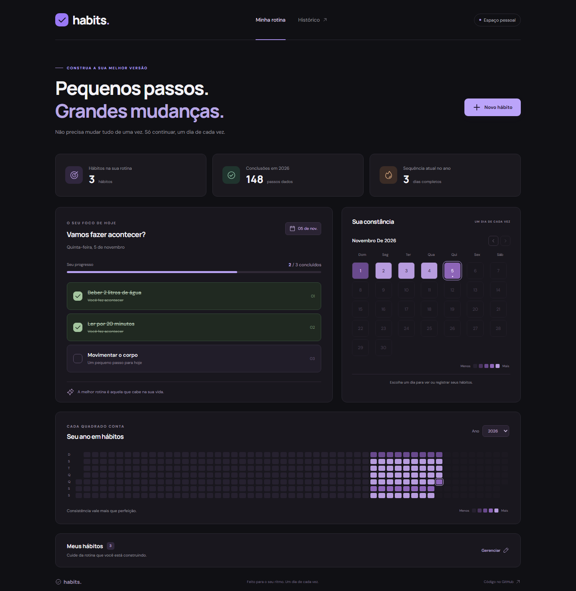

<p align="center">
  
</p>

# Habits · um dia de cada vez

Um espaço pessoal para cultivar hábitos, registrar pequenas conquistas e acompanhar a constância ao longo do ano. Projeto iniciado no NLW da Rocketseat e recuperado como uma aplicação funcional para uso pessoal e portfólio.

**React 18 · TypeScript · Vite 8 · Fastify 5 · Prisma 7 · SQLite**



## O que você pode fazer

- Criar hábitos com recorrência semanal, todos os dias ou dias úteis.
- Marcar e desmarcar conclusões de hoje e de dias anteriores à data atual.
- Navegar pelo calendário mensal e pelo histórico anual, incluindo anos bissextos.
- Acompanhar conclusões, dias completos e sequência de dias no ano atual.
- Renomear hábitos mantendo a recorrência e o histórico.
- Excluir hábitos com confirmação e remoção das marcações relacionadas.
- Usar a interface pelo celular, com navegação por teclado e mensagens de carregamento, sucesso e erro.

A aplicação persiste os registros em SQLite. A página reflete cadastros e marcações sem precisar ser recarregada.

## Executar localmente

Requer **Node.js 24 LTS** e npm. Na raiz do repositório:

```bash
npm ci
npm run setup
npm run dev
```

Abra [http://127.0.0.1:5173](http://127.0.0.1:5173). A API fica em [http://127.0.0.1:3333/api/health](http://127.0.0.1:3333/api/health).

O comando `setup` cria o arquivo `setup/aulas/server/.env` apenas se ele ainda não existir, gera o Prisma Client e aplica as migrações em um banco novo, `setup/aulas/server/prisma/habits.db`.

O banco `dev.db` original, versionado no projeto de estudo, é preservado. A aplicação recuperada começa vazia; esse banco antigo não é importado automaticamente, pois os exemplos originais usam outra convenção de fuso horário.

Para experimentar com dados fictícios:

```bash
npm run db:seed
```

O seed adiciona três hábitos de demonstração e marcações dos últimos 60 dias. Ele não apaga os hábitos existentes nem sobrescreve demonstrações já cadastradas.

## Executar a versão compilada

```bash
npm run build
npm start
```

Abra [http://127.0.0.1:3333](http://127.0.0.1:3333). O Fastify serve a interface compilada e a API no mesmo endereço; o Vite não é necessário nessa modalidade.

A aplicação foi projetada para uma pessoa, sem contas de usuários. Uma instância compartilha o mesmo conjunto de hábitos. Para hospedar, use um disco persistente para o SQLite e controle de acesso à instância antes de disponibilizar registros pessoais na internet. O projeto não inclui serviço de hospedagem nem publicação automática.

## Configuração

O exemplo completo está em [`.env.example`](setup/aulas/server/.env.example).

| Variável       | Padrão                    | Uso                                                      |
| -------------- | ------------------------- | -------------------------------------------------------- |
| `DATABASE_URL` | `file:./prisma/habits.db` | Arquivo SQLite, relativo à pasta da API                  |
| `APP_TIMEZONE` | `America/Sao_Paulo`       | Define qual é o dia atual                                |
| `HOST`         | `127.0.0.1`               | Interface de rede da API                                 |
| `PORT`         | `3333`                    | Porta da API                                             |
| `WEB_ORIGIN`   | `http://localhost:5173`   | Origem permitida em requisições diretas de outro domínio |

A interface usa `/api` no próprio endereço. Em desenvolvimento, o Vite encaminha essas requisições para a API. Para alterar esse destino, configure `VITE_API_PROXY`; para uma API em outro domínio, configure `VITE_API_URL` antes do build e ajuste `WEB_ORIGIN`.

Para fazer backup, encerre a API e copie `habits.db`. Para restaurar, encerre a API e substitua o arquivo por uma cópia compatível.

## Regras de negócio

- Datas da API usam `AAAA-MM-DD` e são armazenadas à meia-noite UTC como dias de calendário, sem deslocamento na interface.
- O dia atual é calculado no fuso configurado, independentemente do fuso do servidor.
- Um hábito só pode ser concluído a partir de sua criação, em um dia da semana previsto e até hoje.
- Marcar uma conclusão é uma operação idempotente: repetir a mesma requisição não desfaz a marcação.
- O resumo conta também hábitos previstos em dias sem nenhuma conclusão registrada.
- A sequência considera dias previstos com todos os hábitos concluídos. Dias de descanso não quebram a sequência; hoje pode estar em andamento. O indicador é limitado ao ano atual.
- A renomeação preserva a recorrência. Para mudar a agenda, crie outro hábito; isso evita reescrever a programação do histórico.
- A exclusão remove o hábito e suas marcações, recalculando o histórico. A interface pede confirmação.

## Qualidade e testes

```bash
npm run check
npx playwright install chromium
npm run test:e2e
npm run format:check
```

Os testes da API usam o banco real SQLite em arquivos temporários separados e validam recorrência, datas, idempotência, persistência, renomeação e exclusão. Os testes do Playwright exercitam os fluxos completos em desktop e celular, usando as portas 3334/5174 e um banco exclusivo de testes.

A integração contínua executa instalação, configuração, testes, build e testes de navegador no GitHub Actions. Em caso de falha, preserva traces e capturas de tela.

## Estrutura

```text
scripts/                    Configuração inicial
setup/aulas/server/
  prisma/                   Schema, migrações e demonstração opcional
  src/app.ts                Aplicação testável e tratamento de falhas
  src/routes.ts             Rotas e regras de hábitos
  src/dates.ts              Datas de calendário e fuso
  src/lib/database.ts       Cliente Prisma e adaptador SQLite
  test/                     Testes de integração da API
setup/aulas/web/
  src/components/           Formulário, calendário e histórico
  src/lib/api.ts            Comunicação e tratamento de falhas
  src/utils/dates.ts        Datas de calendário na interface
  src/App.tsx               Rotina e gerenciamento dos hábitos
e2e/                        Testes de navegador
```

## API

Todas as rotas usam o prefixo `/api`.

| Método | Rota                     | Função                                       |
| ------ | ------------------------ | -------------------------------------------- |
| GET    | `/health`                | Estado da aplicação e data atual             |
| GET    | `/habits`                | Listar hábitos e recorrência                 |
| POST   | `/habits`                | Criar com `{ title, weekDays }`; domingo = 0 |
| PATCH  | `/habits/:id`            | Renomear com `{ title }`                     |
| DELETE | `/habits/:id`            | Excluir e remover marcações                  |
| GET    | `/day?date=AAAA-MM-DD`   | Hábitos possíveis e concluídos               |
| PUT    | `/habits/:id/completion` | Definir `{ date, completed }`                |
| GET    | `/summary?year=2026`     | Contagens por dia do ano                     |

A antiga rota `PATCH /habits/:id/toggle` foi substituída pela conclusão explícita com data. Títulos vazios, recorrências inválidas e datas inexistentes retornam 400; hábitos inexistentes retornam 404.

---

Mantido por **Will Oliveira** · [GitHub](https://github.com/Will-Ifes) · [LinkedIn](https://www.linkedin.com/in/wildemberg-de-jesus-oliveira/)
